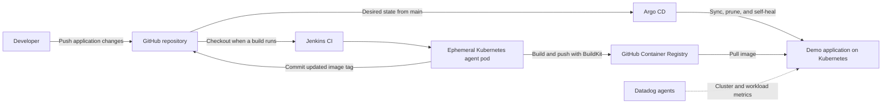

# DevOps Flagship Platform

A local DevOps portfolio project demonstrating container delivery through **Jenkins, Kubernetes, GitHub Container Registry, and Argo CD**, with Helm configuration for Datadog monitoring.

The project models a production-style delivery workflow on a lightweight k3s cluster. A small NGINX application keeps the focus on platform engineering: building images, managing Kubernetes workloads, tracking deployments in Git, and configuring observability.

## Project evidence

Screenshots of the running platform will be collected in [`docs/screenshots/`](docs/screenshots/). The capture checklist covers a successful Jenkins pipeline, Argo CD **Synced / Healthy**, the Datadog cluster view, and the running demo application. Screenshots are pending; the repository currently documents configuration rather than visual proof of a live deployment.

## Architecture



**Jenkins handles CI; Argo CD handles delivery.** Jenkins publishes the image and commits its tag to the deployment manifest. Argo CD watches that manifest and reconciles the cluster with Git. The pipeline does not run a deployment command against the application.

## What this project demonstrates

- **CI pipeline design:** manifest validation, repository checks, image builds, registry publishing, and automated Git updates.
- **GitOps delivery:** automated synchronization, pruning, and drift correction through Argo CD.
- **Ephemeral build infrastructure:** Jenkins creates Kubernetes agent pods containing tools and a BuildKit daemon.
- **Container packaging:** a static HTML application served by `nginx:alpine`.
- **Kubernetes workload configuration:** a development namespace, Deployment, ClusterIP Service, and explicit CPU and memory requests and limits.
- **Platform configuration:** Helm values for Jenkins resources and persistence, plus Datadog cluster metrics.
- **Credential handling:** Jenkins credential bindings for registry and Git access, with temporary authentication files removed after builds.

## Technology stack

| Technology | Role |
| --- | --- |
| k3s / Kubernetes | Local cluster and application runtime |
| Jenkins | CI orchestration with Kubernetes agents |
| BuildKit | Container image build and push |
| GitHub | Application source and desired deployment state |
| GitHub Container Registry (GHCR) | Container image storage |
| Argo CD | GitOps reconciliation and delivery |
| Helm | Jenkins and Datadog configuration |
| Datadog | Cluster and workload metrics configuration |
| NGINX | Demo web application server |

## Repository layout

```text
.
├── Jenkinsfile                         # CI pipeline and GitOps manifest update
├── app/
│   ├── Dockerfile                      # NGINX container image
│   └── index.html                      # Demo page and project explanation
├── argocd/
│   └── dev-demo-app.yaml                # Argo CD Application
├── helm/
│   ├── datadog/values.yaml              # Datadog Helm values
│   └── jenkins/values.yaml              # Jenkins Helm values
└── kubernetes/dev/
    ├── namespace.yaml                  # Development namespace
    └── demo-app/
        ├── deployment.yaml             # Image, replicas, and resources
        └── service.yaml                # Internal HTTP service
```

## Delivery workflow

When a Jenkins build runs, the pipeline:

1. Starts a Kubernetes agent pod with an Alpine tools container and a privileged BuildKit container.
2. Installs Git, curl, and `kubectl`, then checks out the repository.
3. Generates an image tag using `<build-number>-<short-commit>`, linking the artifact to its build and source revision.
4. Validates the Kubernetes manifests with `kubectl create --dry-run=client` and checks that required files exist.
5. Builds the application image and pushes it to `ghcr.io/dionis1/flagship-demo-app`.
6. Updates the image reference in `kubernetes/dev/demo-app/deployment.yaml` and commits the change to `main`.
7. Reports the published image. Argo CD then detects the Git change and synchronizes the application independently.

The Argo CD Application tracks `main` at `kubernetes/dev/demo-app` and targets the `dev` namespace. Automated pruning removes managed resources deleted from Git; self-healing corrects changes made directly to managed cluster resources.

## Run the application locally

To preview the demo page, install Docker and run these commands from the repository root:

```bash
docker build -t flagship-demo-app:local ./app
docker run --rm -p 8080:80 flagship-demo-app:local
```

Open [http://localhost:8080](http://localhost:8080). Stop the container with `Ctrl+C`.

## Run the GitOps workflow

### Prerequisites

The repository contains application manifests and platform values, rather than a complete cluster bootstrap. Before running the workflow, prepare:

- A Kubernetes cluster, such as k3s, with a working `kubectl` context.
- Jenkins installed with the plugins listed in `helm/jenkins/values.yaml`, and a Kubernetes cloud configured to launch pipeline agents.
- Storage supporting the Jenkins persistent volume configuration.
- Cluster permissions and policies that allow the pipeline agent to run privileged BuildKit. The tools stage also runs as root and downloads a Linux AMD64 `kubectl` binary.
- Argo CD installed in the `argocd` namespace, with repository access configured if required.
- Network access to GitHub, GHCR, and the tools and images used by the pipeline.
- Docker registry pull credentials in `dev` if the application image is private. The current Deployment does not define `imagePullSecrets`.

### Configure Jenkins

Use `helm/jenkins/values.yaml` when installing or updating Jenkins with its Helm chart. Create a Pipeline job that loads the repository's `Jenkinsfile` from source control.

Add these username/password credentials in Jenkins:

| Credential ID | Purpose |
| --- | --- |
| `ghcr-creds` | GitHub username and token authorized to publish the GHCR image |
| `github-push` | GitHub username and token authorized to push deployment commits to the repository's `main` branch |

The image repository and Git push URL are configured for `dionis1`. For your own fork, update `IMAGE_REPO` and the push URL in `Jenkinsfile`, the repository URL in the Argo CD Application, and the Deployment image reference. Update the Dockerfile's source label as well.

Configure the job's build trigger separately. If using webhooks or SCM polling, exclude the pipeline's generated deployment commits from triggering another build to avoid a build loop. Branch protection must also permit the chosen deployment update workflow.

### Register the application with Argo CD

With Argo CD installed and the correct cluster context selected:

```bash
kubectl apply -f kubernetes/dev/namespace.yaml
kubectl apply -f argocd/dev-demo-app.yaml
```

Run the Jenkins pipeline to publish an image and update Git. Check the Argo CD application and Kubernetes rollout:

```bash
kubectl get applications.argoproj.io demo-app-dev -n argocd
kubectl rollout status deployment/demo-app -n dev
kubectl get pods,svc -n dev
kubectl port-forward service/demo-app 8080:80 -n dev
```

Open [http://localhost:8080](http://localhost:8080). The Service is internal to the cluster; port forwarding provides local access.

### Configure monitoring

Use `helm/datadog/values.yaml` with the Datadog Helm chart. Before installation, create the referenced `datadog-secret` in the namespace used for Datadog, containing the chart's required API key entry. Keep the API key outside Git.

The values target the Datadog EU site (`datadoghq.eu`), name the cluster `devops-portfolio`, and add development and project tags. They enable the Cluster Agent and Kubernetes state metrics, while disabling logs, the APM port, and the process agent. The repository does not include custom dashboards or alert definitions.

## Design choices and current scope

- **Small application, visible delivery path:** a static page makes it easy to inspect the image build and deployment flow without additional application dependencies.
- **Resource-conscious configuration:** the app runs one replica with requests of `50m` CPU and `32Mi` memory, and limits of `200m` CPU and `128Mi` memory. Jenkins also has explicit resource settings and persistence configuration.
- **Build-specific image tags:** each pipeline run publishes a new tag instead of reusing a shared deployment tag. Base images and the BuildKit image are currently unpinned.
- **Development environment:** the repository currently defines one environment, with no ingress, TLS, application health probes, or application-specific automated test suite. The pipeline's basic tests check file presence; manifest validation is a separate stage.
- **Separate CI and delivery status:** Jenkins success means the image was published and the manifest update was pushed. It does not confirm that Argo CD synchronized successfully or that the rollout is healthy.

## Future improvements

- Add readiness and liveness probes, plus an HTTP smoke test after deployment.
- Pin base images and platform chart versions for reproducible builds.
- Add image vulnerability scanning and stricter manifest validation.
- Extend the GitOps layout with staging and production promotion.
- Add ingress and TLS, Datadog dashboards and alerts, and documented cluster bootstrap steps.
- Evaluate rootless BuildKit and tighter agent permissions.

## Learning and AI assistance

This project is a practical exercise in CI/CD design, Kubernetes workload management, GitOps, resource planning, and platform troubleshooting. The application page describes AI use as learning and troubleshooting assistance, with infrastructure setup, debugging, testing, and deployment performed and verified by the project author.

This README documents the configuration present in the repository; live cluster operation and deployment results need to be verified in the running environment.
