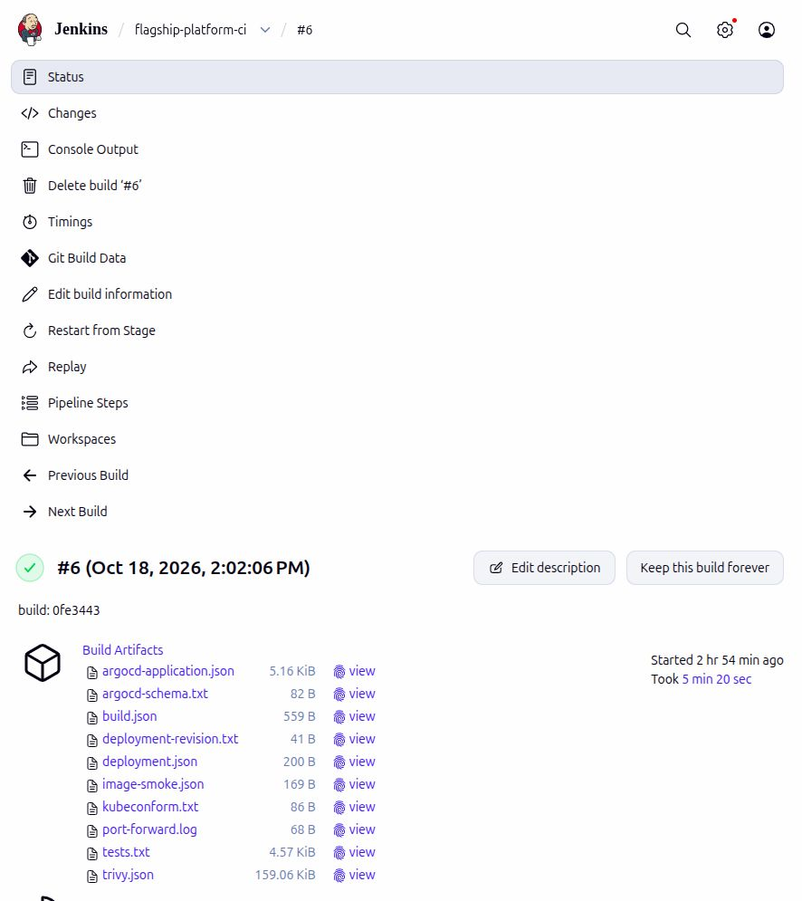
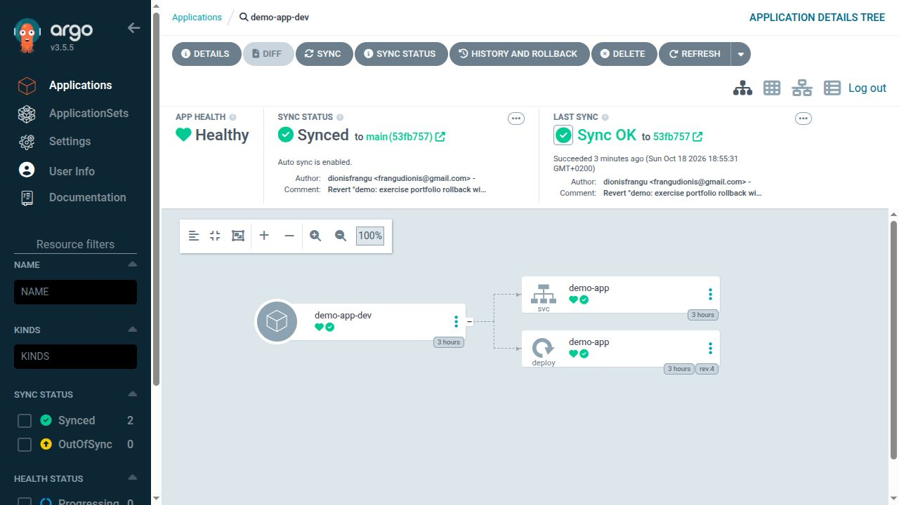
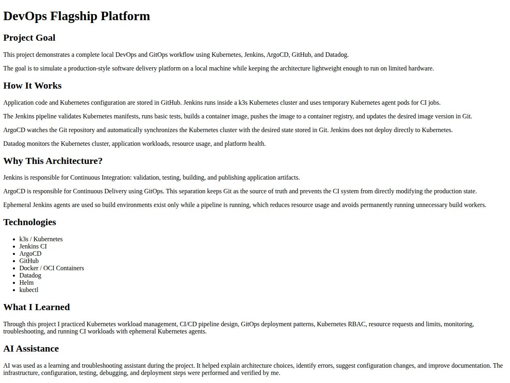
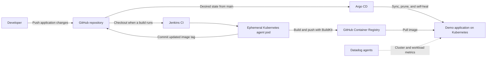

# DevOps Flagship Platform

A local DevOps portfolio project demonstrating container delivery through **Jenkins, Kubernetes, GitHub Container Registry, and Argo CD**, with Helm configuration for Datadog monitoring.

> **Portfolio demonstration only.** This repository is a personal learning and showcase project. It is **not intended for real development, staging, or production workloads**, shared infrastructure, or sensitive data. The `dev` namespace is part of the demonstration, not a supported development platform.

The project models a production-style delivery workflow on a lightweight k3s cluster. A small NGINX application keeps the focus on platform engineering: building images, managing Kubernetes workloads, tracking deployments in Git, and configuring observability.

## Project evidence

**Latest live verification — 18 October 2026:** Jenkins build **#6** passed all **43 tests**, the image scan with **zero HIGH/CRITICAL findings**, the Kubernetes image HTTP test, Git promotion, and exact-revision Argo CD/Service verification. Builds **#7** and **#8** then skipped generated deployment and documentation-only commits without rebuilding. See the [artifact-derived evidence summary](docs/evidence/latest-delivery.json) and [verification record](docs/verification-results.md). Datadog is intentionally off in the rebuilt lab.

Fresh screenshots captured on **18 October 2026** show the rebuilt lab. Older Datadog captures remain in the [full gallery](docs/screenshots/README.md), explicitly labeled historical; Datadog was not enabled for this session.

### Successful Jenkins pipeline

Build **#6** completed the delivery gates and archived the test, scan, image smoke-test, and deployment reports.



### Verified GitOps rollback

A live image change at `708be25` was reverted by Git commit `53fb757`. Argo CD reconciled both exact revisions; the expected image, healthy rollout, and Service HTTP response passed verification each time. The original image is restored. See the [rollback procedure and results](docs/rollback.md) and [machine-readable record](docs/evidence/rollback.json).



### Running demo application

The restored application served this page through its Kubernetes Service and a loopback port-forward. The page's Datadog description reflects the original architecture; monitoring is currently off.



## Architecture



**Jenkins handles CI; Argo CD handles delivery.** Jenkins publishes the image and commits its tested digest to the deployment manifest. Argo CD watches that manifest and reconciles the cluster with Git. The pipeline does not run a deployment command against the application.

## What this project demonstrates

- **CI pipeline design:** strict manifest validation, tested change filtering, image builds, vulnerability scanning, HTTP smoke tests, and conflict-safe Git updates.
- **GitOps delivery:** automated synchronization, pruning, and drift correction through Argo CD, followed by verification of the exact Git revision, image digest, rollout, and HTTP response.
- **Ephemeral build infrastructure:** Jenkins creates Kubernetes agent pods containing tools and a BuildKit daemon.
- **Container packaging:** a static HTML application served by `nginx:1.30.6-alpine`.
- **Kubernetes workload configuration:** a development namespace, Deployment, ClusterIP Service, HTTP readiness and liveness probes, and explicit CPU and memory requests and limits.
- **Platform configuration:** Helm values for Jenkins resources and persistence, plus Datadog cluster metrics.
- **Credential handling:** Jenkins credential bindings for registry and Git access, with temporary authentication files removed after builds.

## Technology stack

| Technology | Role |
| --- | --- |
| k3s / Kubernetes | Local cluster and application runtime |
| Jenkins | CI orchestration with Kubernetes agents |
| BuildKit | Container image build and push |
| GitHub | Application source and desired deployment state |
| GitHub Container Registry (GHCR) | Container image storage |
| Argo CD | GitOps reconciliation and delivery |
| Helm | Jenkins and Datadog configuration |
| Datadog | Cluster and workload metrics configuration |
| NGINX | Demo web application server |

## Repository layout

```text
.
├── Jenkinsfile                         # CI gates, promotion, and deployment verification
├── ci/                                 # Test/gate scripts, schemas, and verification RBAC
├── tests/                              # HTTP, trigger, promotion, and verification tests
├── docs/ci-verification.md             # Setup, trust boundaries, and trigger acceptance checks
├── app/
│   ├── Dockerfile                      # NGINX container image
│   └── index.html                      # Demo page and project explanation
├── argocd/
│   └── dev-demo-app.yaml                # Argo CD Application
├── helm/
│   ├── datadog/values.yaml              # Datadog Helm values
│   └── jenkins/values.yaml              # Jenkins Helm values
└── kubernetes/dev/
    ├── namespace.yaml                  # Development namespace
    └── demo-app/
        ├── deployment.yaml             # Image, replicas, and resources
        └── service.yaml                # Internal HTTP service
```

## Delivery workflow

The trusted `main` job first classifies the full change range. Documentation-only and generated image-only updates skip delivery; infrastructure-only changes run validation; application or CI changes run the full flow:

1. Validate Kubernetes manifests against the configured API schema and validate the Argo CD Application against its pinned CRD schema. Run the regression suite.
2. Build and publish a candidate image using BuildKit, recording its immutable registry digest.
3. Scan that digest with Trivy. HIGH/CRITICAL findings or scanner errors block promotion.
4. Run the candidate in a temporary pod and require HTTP 200 plus expected application content.
5. Fetch current `main`, reject superseded builds and competing deployments, and commit the tested image digest without force-pushing.
6. Verify Argo CD reconciled the exact deployment commit, the expected image is rolled out and ready, and the application responds through its Service. Archive scan results and deployment diagnostics.

Builds are serialized. A lightweight skipped build never launches the privileged BuildKit pod. The job does not enable webhooks automatically: test your job's trigger behavior before enabling automatic delivery. The [CI operating guide](docs/ci-verification.md) covers permissions, credential scope, trigger acceptance checks, failure behavior, and local tests. See the [verification record](docs/verification-results.md) for the checks actually run and their limits.

The Argo CD Application tracks `main` at `kubernetes/dev/demo-app` and targets the `dev` namespace. Automated pruning removes managed resources deleted from Git; self-healing corrects changes made directly to managed cluster resources.

## Run the application locally

To preview the demo page, install Docker and run these commands from the repository root:

```bash
docker build -t flagship-demo-app:local ./app
docker run --rm -p 8080:80 flagship-demo-app:local
```

Open [http://localhost:8080](http://localhost:8080). Stop the container with `Ctrl+C`.

## Run the GitOps workflow

For the rebuilt Docker-hosted local lab, see [local setup and access](local/README.md). It includes start/stop commands that preserve cluster data and reclaim RAM.

### Prerequisites

The repository contains application manifests and platform values, rather than a complete cluster bootstrap. Before running the workflow, prepare:

- A Kubernetes cluster, such as k3s, with a working `kubectl` context.
- Jenkins installed with the plugins listed in `helm/jenkins/values.yaml`, and a Kubernetes cloud configured to launch pipeline agents.
- Storage supporting the Jenkins persistent volume configuration.
- The verification ServiceAccount and namespace-scoped RBAC from `ci/verification-rbac.yaml`; see the [one-time setup](docs/ci-verification.md#one-time-cluster-setup).
- Cluster permissions and policies that allow the pipeline agent to run privileged BuildKit. The tools stage also runs as root and downloads a Linux AMD64 `kubectl` binary.
- Argo CD installed in the `argocd` namespace, with repository access configured if required.
- Network access to GitHub, GHCR, and the tools and images used by the pipeline.
- Docker registry pull credentials in `dev` and `ci-tests` if the application image is private. The current Deployment does not define `imagePullSecrets`.

### Configure Jenkins

Use `helm/jenkins/values.yaml` when installing or updating Jenkins with its Helm chart. Create a Pipeline job that loads the repository's `Jenkinsfile` from source control.

Add these username/password credentials in Jenkins:

| Credential ID | Purpose |
| --- | --- |
| `ghcr-creds` | GitHub username and token authorized to publish the GHCR image |
| `github-push` | GitHub username and token authorized to push deployment commits to the repository's `main` branch |

The image repository and Git push URL are configured for `dionis1`. For your own fork, update `IMAGE_REPO` in `Jenkinsfile` and the default push URL in `ci/promote.py`, the repository URL in the Argo CD Application, and the Deployment image reference. Update the Dockerfile's source label as well.

Configure the job's build trigger separately. If using webhooks or SCM polling, exclude the pipeline's generated deployment commits from triggering another build to avoid a build loop. Branch protection must also permit the chosen deployment update workflow.

### Register the application with Argo CD

With Argo CD installed and the correct cluster context selected:

```bash
kubectl apply -f kubernetes/dev/namespace.yaml
kubectl apply -f argocd/dev-demo-app.yaml
kubectl apply -f ci/verification-rbac.yaml
```

Run the Jenkins pipeline to test and scan a candidate image, update Git, and verify the resulting deployment. You can also inspect the Argo CD application and Kubernetes rollout manually:

```bash
kubectl get applications.argoproj.io demo-app-dev -n argocd
kubectl rollout status deployment/demo-app -n dev
kubectl get pods,svc -n dev
kubectl port-forward service/demo-app 8080:80 -n dev
```

Open [http://localhost:8080](http://localhost:8080). The Service is internal to the cluster; port forwarding provides local access.

### Configure monitoring

Use `helm/datadog/values.yaml` with the Datadog Helm chart. Before installation, create the referenced `datadog-secret` in the namespace used for Datadog, containing the chart's required API key entry. Keep the API key outside Git.

The values target the Datadog EU site (`datadoghq.eu`), name the cluster `devops-portfolio`, and add development and project tags. They enable the Cluster Agent and Kubernetes state metrics, while disabling logs, the APM port, and the process agent. The repository does not include custom dashboards or alert definitions.

## Security limitations and intended use

This project demonstrates delivery concepts on a local machine. Passing its tests and vulnerability scan does not make the platform safe for operational use.

| Limitation | What it means in this lab | What a real platform would need |
| --- | --- | --- |
| Privileged BuildKit | The build container has `privileged: true`. Malicious build instructions or a builder vulnerability could affect the node and other workloads. Kubernetes namespace RBAC does not contain this privilege. | A verified rootless configuration or isolated disposable build infrastructure. |
| Automated pushes to `main` | Jenkins can update the deployment manifest and Argo CD deploys it automatically. Tests, scanning, serialization, and stale-update rejection reduce mistakes but do not provide independent approval. | Protected environment promotion with appropriate access controls and review. A self-merged PR adds visibility, not independent authorization. |
| Shared build and credential boundary | Build and promotion steps share an agent pod/workspace. A compromised privileged builder could threaten credentials made available there. Moving steps into separate jobs on the same exposed node is not sufficient isolation. | Separate execution and credential boundaries, with minimum permissions and short-lived credentials. |
| Local service security | The rebuilt lab uses loopback-bound web ports, including HTTP, and a Kubernetes version selected to match the demonstration's API target. This is not a hardened, supported service configuration. | Maintained platform versions, appropriate TLS/authentication, network controls, and operational ownership. |
| Limited operating scope | One local node and a static NGINX page demonstrate a small delivery path, not high availability, business application correctness, or disaster recovery. | Workload-specific testing, recovery planning, and controls appropriate to the actual service. |

Only trusted code should run in this lab. Do not expose its web ports to a network or connect real application data. Keep secrets outside Git. GitHub/Jenkins token permissions and expiry are external account settings: the repository documents the required scopes but cannot prove that an installed token has only those permissions. See the [credential guidance](docs/ci-verification.md#credentials-and-trust-boundaries).

These limitations are retained to keep a solo portfolio project understandable and affordable to run. They are not recommendations for a development or production platform. Rootless building and reviewed environment promotion remain future experiments; they are not implemented security guarantees.

## Design choices and current scope

- **Small application, visible delivery path:** a static page makes it easy to inspect the image build and deployment flow without additional application dependencies.
- **Resource-conscious configuration:** the app runs one replica with requests of `50m` CPU and `32Mi` memory, and limits of `200m` CPU and `128Mi` memory. Jenkins also has explicit resource settings and persistence configuration.
- **Build-specific image tags:** each application build publishes a build-specific candidate tag; promotion records its immutable digest in Git. NGINX is pinned to `1.30.6-alpine`, with the patched `libexpat=2.9.0-r0` package, and BuildKit to `v0.33.1`. Version tags make base/builder upgrades explicit; pinning those inputs by digest would strengthen reproducibility further. The Alpine tools image still uses the `3.20` release tag.
- **Application health:** both probes request `/` on port 80. Readiness starts after 5 seconds and runs every 5 seconds; three consecutive failures remove the pod from Service endpoints. Liveness starts after 10 seconds and runs every 10 seconds; three consecutive failures trigger a container restart. Each request has a 2-second timeout.
- **Demonstration environment:** the repository currently defines one environment, with no ingress or TLS. CI exercises HTTP behavior, change classification, Git promotion races, deployment-state verification, and strict manifest validation. Live webhook behavior still requires the documented Jenkins acceptance checks.
- **Lab security and promotion tradeoffs:** Jenkins pushes deployment commits directly to `main`, and its BuildKit agent runs privileged. These keep the local workflow simple; production adoption would require tighter build isolation and a reviewed promotion workflow. The original Helm values leave plugin versions unpinned; the rebuilt local setup separately pins the Jenkins chart and all plugin archives with checksums. This does not remove the privileged-builder risk.
- **Verified delivery:** full build success requires the scanned and HTTP-tested digest to be deployed at the intended Git revision, with a healthy rollout and successful Service HTTP check. Validation-only and skipped jobs report their action separately. The refreshed Jenkins screenshot shows this verified run; archived JSON records provide the detailed results.

## Future improvements

- Pin remaining base/builder image inputs by digest and align the original Helm values with the rebuilt setup’s pinned chart/plugin configuration.
- Extend the GitOps layout with staging and production promotion through pull requests or a dedicated environment repository or branch.
- Add ingress and TLS, Datadog dashboards and alerts, and documented cluster bootstrap steps.
- Evaluate rootless BuildKit and tighter agent permissions.

## Learning and AI assistance

This project is a practical exercise in CI/CD design, Kubernetes workload management, GitOps, resource planning, and platform troubleshooting. The application page describes AI use as learning and troubleshooting assistance, with infrastructure setup, debugging, testing, and deployment performed and verified by the project author.

This README documents the repository configuration and the platform state shown in the captured screenshots. The screenshots are historical evidence; current cluster operation and deployment results need to be verified in the running environment.
