# Project screenshot gallery

Screenshots supplied by the project author from the local platform on **14 October 2026**. They capture different moments during the session, so statuses and build numbers can differ between views. The main [README](../../README.md#project-evidence) highlights the CI, GitOps, and monitoring evidence.

The Jenkins and Argo CD views connect build **#16**, source revision `379f6ff`, image tag `16-379f6ff`, and deployment revision `beba98c`. These identify the captured deployment, not necessarily the latest version of the repository.

## Jenkins pipeline

Successful builds #15 and #16, with all pipeline stages visible.

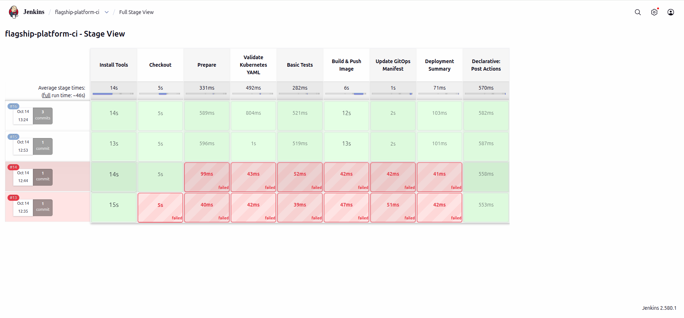

## Jenkins dashboard

Job overview showing build #15 as the latest successful run at capture time.

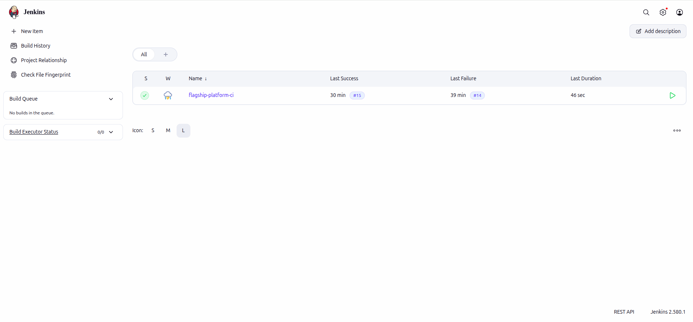

## Jenkins build changes

Build #16 source changes, including source revision `379f6ff`.

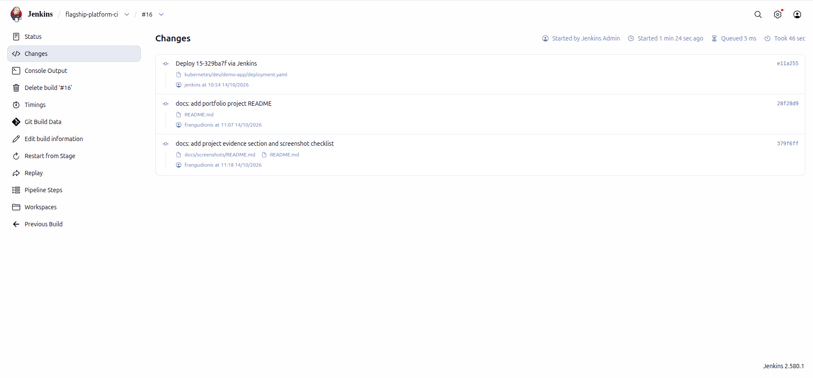

## Argo CD workload tree

Synced and Healthy application at deployment revision `beba98c`, referencing image tag `16-379f6ff`.

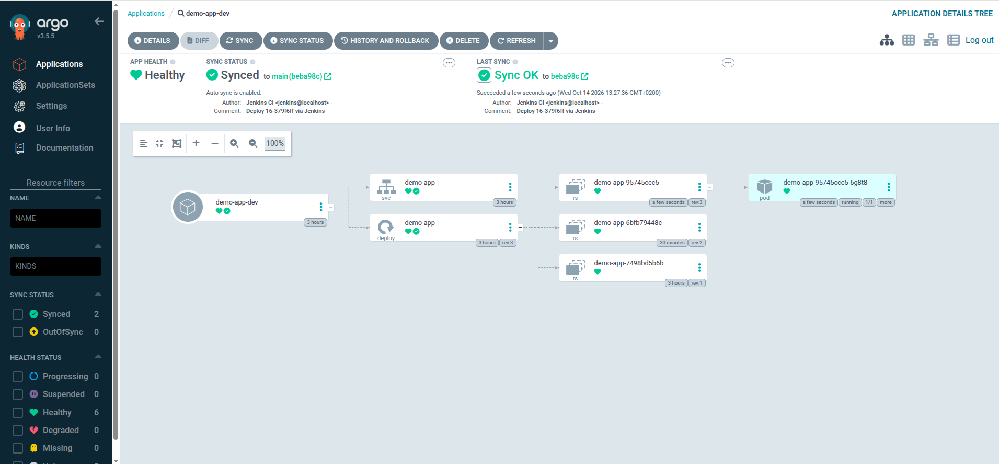

## Argo CD application overview

Repository path, development namespace, and application status.

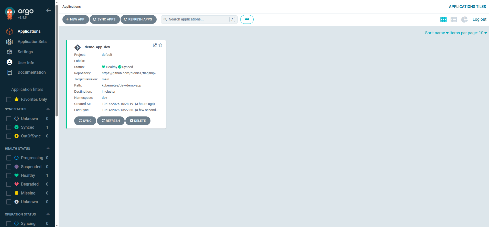

## Argo CD Service details

The demo application ClusterIP Service in the `dev` namespace.

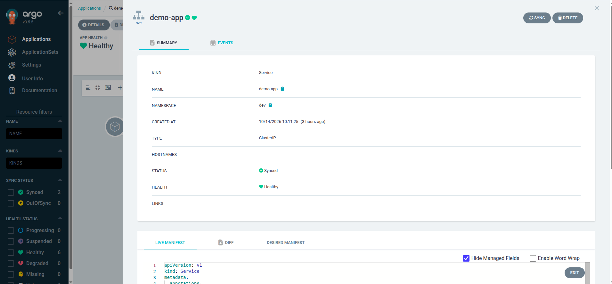

## Datadog cluster namespaces

Namespace inventory with pod statuses and CPU and memory usage.

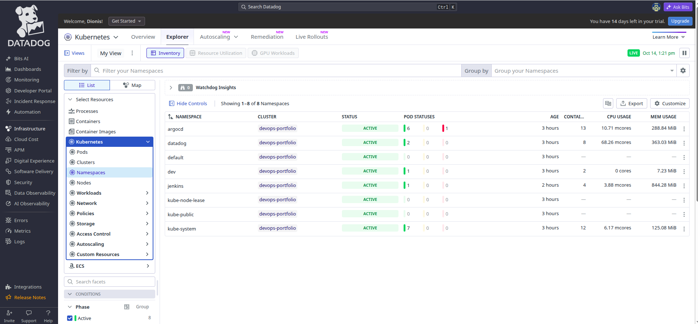

## Datadog containers

Container inventory and resource usage; this view also includes other local lab containers.

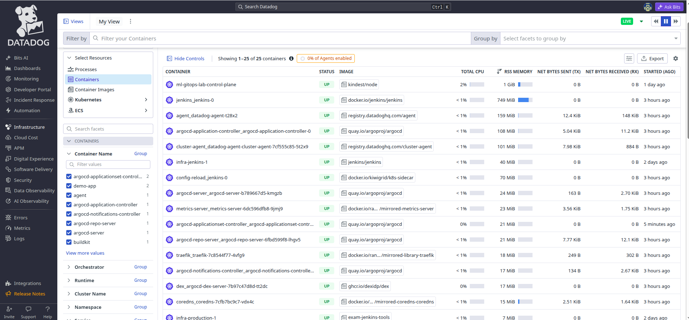

## Datadog Kubernetes services

Service inventory including the demo app, Jenkins, Argo CD, and Datadog.

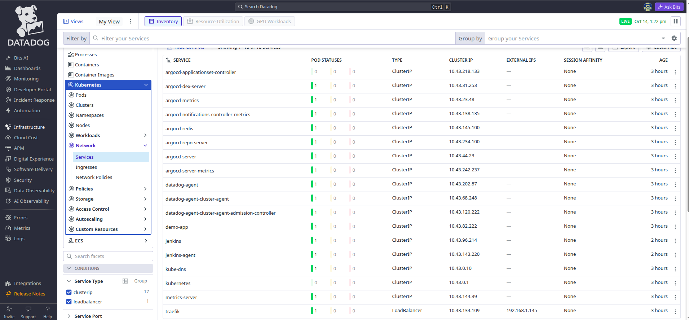

## Datadog monitor overview

Monitor list showing 13 OK monitors and two alerts at capture time.

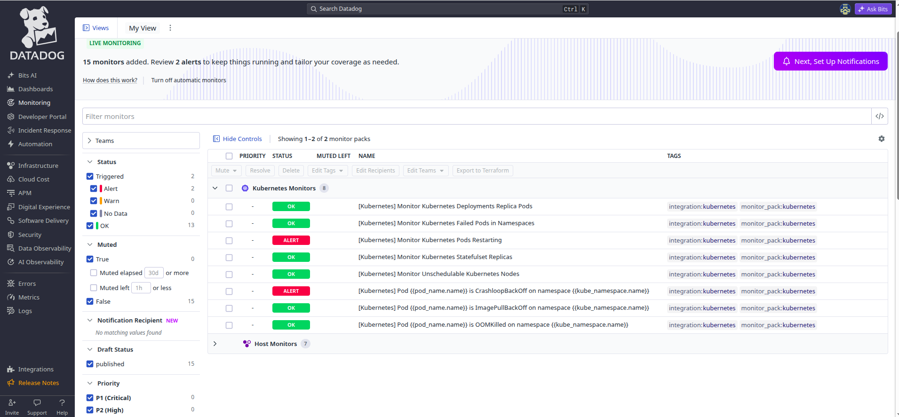

## Datadog deployment replica monitor

Four-hour metric window with 12 OK groups and one No Data group.

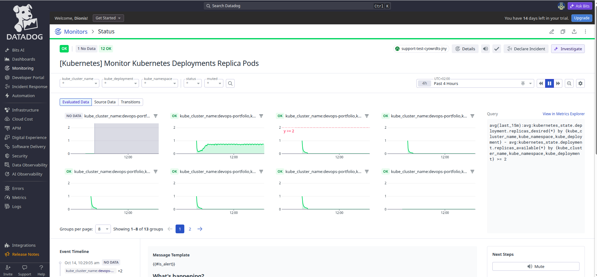

## Additional evidence to capture

A browser screenshot of the demo web page is not included yet. The Argo CD views show the running workload and Service; a web page capture would add evidence of the application response.
